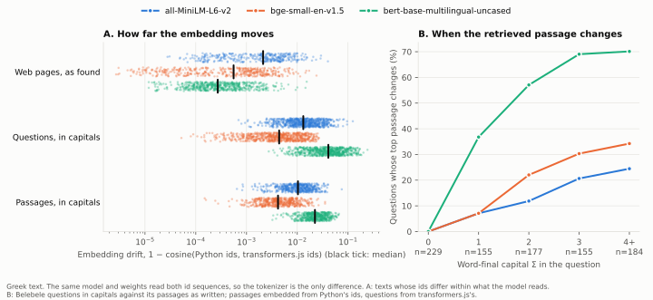

# Tokenizer CPU

[](https://github.com/fMindstormer/tokcpu/actions/workflows/test.yml)

A stock Hugging Face tokenizer that runs Brainfuck. It is a plain `tokenizer.json`, with no custom
code and no model. Every clock tick is one encode and one decode:

```python
from transformers import AutoTokenizer

tok = AutoTokenizer.from_pretrained("tokenizers/brainfuck")
while (nxt := tok.decode(tok.encode(tape))) != tape:
    tape = nxt
```

Start the tape with a Brainfuck program written on it and the loop ends with the program's output
written there too:

```
⊢Hello World!␊┃++++++++[>++++[>++>+++>+++>+<<<<-]>+>+>->>+[<]<-]>>.>---.+++++++..+++.>>.<-.<.+++.------.--------.>>+.>++.▼가║⠀⠀⡈⡤⡗⠡▲⠊⊣
 └── output ──┘ └──────────────────────────────── the program ───────────────────────────────────────┘  └─ memory ─┘
```

**On the Hugging Face Hub:** [fMindstormer/tokcpu](https://huggingface.co/fMindstormer/tokcpu), so
`AutoTokenizer.from_pretrained("fMindstormer/tokcpu")` loads the universal tokenizer, with Hello World's
tape in its `start.txt`.

**Interactive page:** https://fmindstormer.github.io/tokcpu/ runs these same files in the browser with
transformers.js, and compiles Turing machines you type into new tokenizers you can download.

## How one tick works

The tape is a string. Exactly one character on it is the *head*: a marker that stands for a machine
state and reads the character beside it, on its right or its left depending on the marker.

1. **Encode finds the head.** The BPE model has one merge rule for each pair the head can form with a
   cell, and no other merges. So the tape splits into single characters plus one two-character token:
   the head and the cell it reads.
2. **The id is the rule.** Each such pair has its own id, and that id stands for one Turing-machine
   rule: what to write, which way to move, which state comes next.
3. **Decode applies it.** The same id is also an *added token* whose text is the rule's output: the new
   symbol with the next head placed beside it. Decoding prints that output where the pair was. Every
   other character decodes to itself.
4. **Halting.** A halting state has no merges, so its tape decodes to itself. The loop stops when the
   tape stops changing.

A head at either end of the tape reads a blank, and its rules can grow the tape there, so the tape is
as long as the program needs.

### The catch: steps would have to be reversible

A token id decodes to exactly one string, and when the library saves a tokenizer (as `transformers`
does internally when it loads one) it keeps one string per id. If two rules wrote the same output, they
would need two added tokens with the same text, which a tokenizer cannot hold. Taken plainly, the
trick only runs machines whose every step can be undone: reversible computers.

Ordinary programs throw information away constantly. So each added token's text is the output plus a
short tag of private-use characters (U+E000 to U+E03F) that makes it unique, and the decoder has one
generic rule: a `Replace` that deletes those characters. That deletion is the only place the machine
forgets anything. The tags never reach the tape, so an added token can never match tape text when
encoding.

The ids line up because the library numbers added tokens after the model's vocabulary, in the order
they are listed. With C single characters and M windows, window k gets id C + M + k, and so does the
k-th added token. Ids C to C + M − 1 are unused; the files still save, reload and run correctly
(the tests check this).

### One pass versus the loop

A single encode is a weak computer. Cognetta and Okazaki showed that BPE tokenization is a
finite-state transduction ([Tokenization as Finite-State Transduction](https://arxiv.org/abs/2410.15696)):
one pass can only look a bounded distance ahead. One tick here rewrites just the two characters around
the head. Repeating the tick, on a tape that can grow, is what makes it Turing complete. The loop is
three lines of Python, the same way "CSS is Turing complete" demos need someone clicking.

## The ladder

| Rung | Tokenizer | Merge rules | File | Program | Ticks |
|---|---|---:|---:|---|---:|
| 1 | binary counter | 7 | 1.5 KB | counts forever | |
| 1 | 4-state busy beaver | 24 | 4 KB | itself | 107 |
| 2 | Hello World, compiled | 38,265 | 5.7 MB | Hello World | 1,194 |
| 2 | alphabet, compiled | 28,301 | 4.2 MB | alphabet | 556 |
| 2 | grid, compiled | 25,474 | 3.8 MB | grid | 477 |
| 2 | jumps, compiled | 24,173 | 3.6 MB | jumps | 531 |
| 3 | universal Brainfuck | 17,210 | 2.6 MB | Hello World | 154,137 |
| 3 | | | | alphabet | 27,053 |
| 3 | | | | grid (nested loops) | 17,474 |
| 3 | | | | jumps (skipped and nested) | 21,415 |
| 3 | | | | reverse, input `stressed` | 1,904 |

- **Rung 1, small machines** (`tokcpu/small.py`). Any Turing machine given as a table. The 4-state busy
  beaver halts after exactly 107 ticks with 13 ones on the tape, its known record.
- **Rung 2, one program per tokenizer** (`compile_program` in `tokcpu/bf.py`). A Brainfuck program
  compiles into a machine whose states are the program: each instruction is one tick. Printing leaves
  a mark at the data pointer, carries the byte left to the output and walks back to the mark.
- **Rung 3, one tokenizer for every program** (`universal` in `tokcpu/bf.py`). The program is written
  on the tape. The head carries each instruction from `▼` (the instruction pointer) to `▲` (the data
  pointer), executes it there, and walks back. Jumps scan for the matching bracket with the loop depth
  held in the state, up to 64 levels. Input waits at the right end of the tape after `¦`, and `,` takes
  its first character.

Both rungs print a byte in two trips, one per nibble. The high nibble goes left and waits before `┃`
as a circled hex digit (`⓪` to `ⓕ`); the head goes back, reads the cell again, and the low nibble
joins it. Carrying the whole byte at once would take 256 carrying states, each with a rule for every
symbol it walks over: that was 92% of the universal tokenizer's rules. Two trips take 32 states, which
cut it from 73,968 rules (11.1 MB) to 15,179 (2.3 MB) for 2% more ticks. Input (`,`) reuses the same
trips the other way: the cell becomes a hole `◌`, the high nibble of the input's first character comes
back and waits in it, and a second trip takes the character and brings the low nibble. It costs 2,031
rules.

Brainfuck details: cells are bytes that wrap; the data tape grows to the right as needed; moving left
of cell 0 stops the machine; `,` reads 0 once the input is used up, and needs the universal tokenizer.
Data cells are Braille characters (U+2800 + value), so the dots spell the byte. Printed and input bytes
appear as themselves when printable, as control pictures below 32 (`␊` is a newline), and as
U+0100 + (byte − 128) above 127.

### Clock speed

The universal tokenizer running Hello World (154,137 ticks), best of three runs on an Apple M4:

| Library | Ticks a second |
|---|---:|
| `tokenizers` 0.23 (Rust, from Python) | 9,200 |
| `transformers` 5.20 AutoTokenizer | 5,900 |
| transformers.js 3.7.6 in Node | 11,700 |
| transformers.js in headless Chromium (the page) | 17,300 |

Speed does not depend on the number of rules; it falls slowly as the tape gets longer.

## Parallel ticks

One encode reads the whole tape, but a single head uses two characters of it. Two ways to use the rest:

**Several heads.** Heads that never meet each get their rule applied in the same tick, with no change to
the compiler. Two busy beavers on one tape finish together in 107 ticks.

**A block cellular automaton** (`tokcpu/blocks.py`). A stock `Split` pre-tokenizer cuts the tape into
two-character blocks before BPE runs, and every block is a merge, so one tick rewrites every block at
once. A phase mark `◦` after the left edge shifts the blocks by one character, and the edge block adds
or drops it, so the blocks alternate between two alignments (the Margolus neighbourhood) and
information can cross block boundaries.

The demo, `tokenizers/sort`, is odd-even transposition sort: each block puts its two letters in order,
and n letters are sorted after at most n ticks. It has 704 rules.

```
⊢◦thequickbrownfoxjumpsoverthelazydog⊣     tick 0
⊢◦abcdeeefghhijklmnoooopqrrsttuuvwxyz⊣     tick 30
```

The mark flips every tick, so the tape never stops changing; a run stops when the tape repeats every
two ticks. A tick costs time in proportion to the tape's length either way, so this buys throughput:
sorting 1,000 letters does about 320,000 block rewrites a second, where one head does about 10,000
rules a second on the same machine. Block cellular automata can be universal too, but this one only
sorts.

## Fuzzing tokenizer runtimes

The same `tokenizer.json` is re-implemented in many runtimes, and they can quietly disagree. Most
cross-checks compare two implementations on sample text, so they can tell that two disagree but not
which one is wrong. Here the machine is an independent oracle: `Machine.step` says what every tick
must give without asking any tokenizer library.

`python -m tokcpu fuzz` (`tokcpu/fuzz.py`) compiles random machines over awkward alphabets (spaces and
controls, quotes and backslashes, combining marks, characters outside the Basic Multilingual Plane)
and writes each one as several tokenizers, one per feature of the format:

- **plain**: variants the format says are equivalent (merges as `"a b"` strings, added tokens marked
  special or normalized, shuffled ids, no Fuse decoder);
- **normalizers**: Lowercase, NFC, NFD, NFKC, NFKD, Strip, Replace and a Sequence, with input noise the
  normalizer must undo (capitals, decomposed or full-width characters, padding);
- **Split pre-tokenizers**: every behaviour, with the pattern written six ways, and separators
  sprinkled on the tape; a rule may only fire if its window lies in one piece;
- **WhitespaceSplit**, with Unicode whitespace and look-alikes that are not whitespace;
- **byte fallback**: characters outside the vocab must survive as byte tokens;
- **added tokens that occur in the input**, with `lstrip` and `rstrip`.

For each feature a small model in `fuzz.py` says what a tick must give, written from the format's
documented behaviour; a test checks every model against the Rust library first. Every tokenizer then
runs in every runtime it finds: `tokenizers`, `transformers`, and, after `cd fuzz && npm install`,
transformers.js 3.7.6 and 4.3.1 and `@huggingface/tokenizers` 0.2.0 (`--node` picks the Node binary).
A disagreement is checked again in a fresh process, shrunk to a one-tick input, and kept with its
tokenizer in `build/fuzz/`.

### What it found

On Node 22, 200 machines and about 372,000 ticks: the two Python runtimes agreed with the models
everywhere. The three JavaScript runtimes disagreed in the same ways, which small probes then pinned
down (all agree with each other, so these are disagreements with the Rust library, the reference):

| | Disagreement | Runtimes |
|---|---|---|
| A | Whitespace means JavaScript's `\s`, not Unicode White_Space: U+FEFF (byte order mark) is stripped or split on, U+0085 (next line) is not. Affects WhitespaceSplit, Strip, and `lstrip`/`rstrip` of added tokens | all three |
| B | A Split with a `String` pattern and behaviour `Removed` keeps the separator (the same pattern as a `Regex` works) | all three |
| C | A Split with `invert: true` is wrong for every behaviour but `Removed` | all three |
| D | A character missing from the vocab, with no `unk_token`: Rust drops it before merging, so `aßb` becomes `ab`; JavaScript merges around it and gives `a`, `b` | 4.3.1, tokenizers.js; 3.7.6 emits a `null` id and crashes in decode |
| E | An added token's `id`: Rust ignores it and numbers added tokens after the vocab; JavaScript uses it, so the same file gives the model different ids | all three |
| F | The Oniguruma escape `\x{B6}` in a regex fails to load | 3.7.6 (fixed in 4.3.1) |

C, D and E came from probes rather than the fuzzer's own features; adding them as features is next.

On Node 24 and 25 and in Chrome 139 there is one more, below all of them: V8's `JSON.parse` can misread
an escaped key, such as a vocab entry `"`, after an earlier parse in the same process, so the token
silently disappears. It is a known V8 bug ([nodejs/node#63785](https://github.com/nodejs/node/issues/63785)),
fixed in V8 and awaiting a Node 24 backport ([nodejs/node#66542](https://github.com/nodejs/node/pull/66542)).
Six popular Hub tokenizers loaded one after another in Node 24 came through intact.

### Real tokenizers

The fuzzer's tokenizers are built to be awkward. To see what reaches real models, `python -m tokcpu
check <repo>...` (`tokcpu/compat.py`) runs Hub tokenizers through the same three JavaScript runtimes on 42
texts (everyday text, 15 languages and scripts, Unicode edge cases, stress cases), and compares their ids
and decoded text with Python. Python has two references: `tokenizers` reading the file as written, and
`transformers`' AutoTokenizer, which adds model-specific behaviour (CLIP's decode turns `</w>` into
spaces). A difference counts only if JavaScript differs from both, or from the only one that loads the
model; where they disagree with each other, JavaScript always sides with one of them.

`python -m tokcpu compat --top 1000` does this for the most-downloaded models, once per distinct
`tokenizer.json`. In October 2026, on Node 22 against `transformers` 5.20 and `tokenizers` 0.23, 500 of
the top 1,000 models had a tokenizer.json (220 distinct files). In transformers.js 4.3.1 and
tokenizers.js 0.2.0, 375 of the 500 matched Python on every text; transformers.js 3.7.6 matched on 362.
Weighted by downloads, the share that matched everywhere was 48%, because the popular BERT-style models
differ on one rare character:

| Cause | Models (transformers.js 4) | What happens |
|---|---|---|
| Final sigma | 84 | Lowercasing a capital Σ at the end of a word gives ς in JavaScript (`toLowerCase` is context-sensitive) and σ in Python. 69 BERT-style WordPiece models (`bert-base-uncased`, `all-MiniLM-L6-v2`, the BGE and E5 families) and 15 CLIP models |
| Whitespace (A above) | 44 | U+FEFF and U+0085 |
| Other | 8 | Arabic-Indic digits in a ByteLevel split, runs of spaces in Metaspace, a zero-width joiner in a Precompiled normalizer |
| Byte fallback ignored | 3 | A Unigram model's `byte_fallback` is not applied, so characters outside the vocab become `<unk>` ([tokenizers.js#26](https://github.com/huggingface/tokenizers.js/issues/26)); SigLIP and ruri-v3 lose German, Chinese and emoji this way |
| Throws | 3 | Decoding an empty list of ids throws instead of returning "" |

On everyday text, only those three byte-fallback models and five others differ. transformers.js 3.7.6
also drops the leading `▁` of Metaspace tokenizers with `prepend_scheme: "first"` (11 models), fixed in 4.

The results are on a [dashboard](https://fmindstormer.github.io/tokcpu/compat/), and `--out` keeps them
as JSON. The run takes about an hour, mostly waiting on the Hub's rate limit, and resumes where it stopped.

**Your own tokenizer.** Before you ship a tokenizer to the browser, check it (after `cd fuzz && npm
install`, on Node 22):

```
python -m tokcpu check your-name/your-model          # a Hub repo; private ones need `hf auth login`
python -m tokcpu check path/to/folder                # or a folder holding tokenizer.json
```

For each runtime, it lists every text where the ids or the decoded text differ from Python, with the
tokens around the first difference and a guess at the cause. It exits with 1 when a runtime differs from
both Python references or cannot load the tokenizer, so it can run in CI.

**New releases.** [`.github/workflows/compat.yml`](.github/workflows/compat.yml) checks every day for a
new release of transformers.js, tokenizers.js, `transformers` or `tokenizers`. When there is one, or the
last run is four weeks old, it runs the top 1,000 again with the latest of each. The results go on the
[`compat-results`](../../tree/compat-results) branch, and its README lists the models that changed since
the run before. To get the same summary locally, run `python -m tokcpu report results.json --previous
old.json`.

### llama.cpp and GGUF

llama.cpp, and what is built on it (Ollama, LM Studio, llama-cpp-python), never reads tokenizer.json. A
converter copies the vocabulary into the GGUF file once, along with a guess at which pre-tokenizer it
needs, and llama.cpp's own code does the rest. `python -m tokcpu gguf` (`tokcpu/gguf.py`) checks the
most-downloaded GGUF repos against the models they were made from, using each repo's
`base_model:quantized:` tag. It runs on the same 42 texts with the same two Python references. It reads
only the start of each GGUF (the header holds the vocabulary, about 8 MB for Llama 3.2) and runs it in an
installed llama.cpp through a small C helper (`fuzz/llama_tok.c`, built on first use; `brew install
llama.cpp`).

```
python -m tokcpu gguf bartowski/Qwen2.5-32B-Instruct-GGUF     # one repo, printed
python -m tokcpu gguf --top 300 --out build/gguf/results.json  # the campaign; `report` reads it too
```

In October 2026, with llama.cpp 0.7.0, 192 of the top 300 GGUF repos could be checked. The rest:

- 24 name no base model;
- 37 are not language models (image, audio, speech);
- 22 have a base model without a tokenizer.json;
- 13 have an architecture this llama.cpp cannot run;
- 10 are gated.

Only 13 of the 192 matched Python on every text (Hunyuan, Spark, Granite 4.2, DeepSeek V4 builds). Each
difference below was put down to a cause by testing it where possible. For example, a difference counts
as "normalizer not applied" only if Python with the normalizer removed gives llama.cpp's exact ids.

| Cause | GGUF repos | What happens |
|---|---|---|
| Normalizer not applied | 130 | Qwen 2 to 3.x ask for NFC; llama.cpp skips it, so a decomposed "é" (e + U+0301) tokenizes as two characters. Only decomposed text shows it (macOS file names, some pasted text), and 92 repos differ in nothing else |
| Special-looking text | 33 | In Qwen 2 and 3 (the `qwen2` pre-tokenizer), llama.cpp turns a literal `</s>` in the text into a control token when it parses special tokens, as llama-server does for prompts. The GGUF and Python both have it as an ordinary token |
| BOS | 26 | llama.cpp adds `<bos>` where tokenizer.json does not: 24 Gemma 4 repos (whose chat template writes `<bos>` itself), LFM2.5-Audio and a MiniCPM5 |
| Decode clean-up | 13 | GLM, LFM2.5, Granite 4.1, Nemotron: llama.cpp decodes `a !== null` as `a!== null`, the old `clean_up_tokenization_spaces`, which 12 of these 13 models turn off |
| Hindi and Thai | 10 | Qwen 3.5, gpt-oss, Llama 4, Nemotron: a virama or vowel sign lands in a different piece (स्त against स + ्त) |
| `\r\n` | 4 | Laguna: one token in Python, two in llama.cpp |
| BERT embeddings | 2 | nomic-embed-text-v1.5 and mxbai-embed-large: decode adds a leading space, a word over 100 characters is split instead of becoming `[UNK]`, and Korean and Hindi accents are stripped differently |

On everyday text, 46 differ, nearly all for three of those reasons: the extra BOS, the space clean-up and
Laguna's `\r\n`, plus the two BERT models. Beyond that, a umt5 text encoder differs in many places, but image
pipelines that load it do their own tokenizing. llama.cpp also aborts, rather than returning an error, when
asked to tokenize with a GGUF whose vocabulary type is `none` (an LFM2.5-Audio tokenizer file).

## Does a disagreement change what the model does?

A different id only matters if the model then does something different. `python -m tokcpu effect`
(`tokcpu/effect.py`) measures this for the most common difference above, final sigma, in three affected
models:

- all-MiniLM-L6-v2 and bge-small-en-v1.5, two of the embedding models most often run in the browser;
- bert-base-multilingual-uncased, an uncased BERT that was trained on Greek.

Each Greek text is tokenized by Python and by transformers.js 4.3.1. Both id sequences then go through the
same model, weights and PyTorch code, so the tokenizer is the only difference. The texts come from two
sources:

- [Belebele](https://huggingface.co/datasets/facebook/belebele): 900 Greek questions on 488 passages of
  edited prose, as written and in capitals, as in a headline, a sign or a search typed with caps lock;
- [FineWeb-2](https://huggingface.co/datasets/HuggingFaceFW/fineweb-2): 5,000 Greek web pages, as found.



**How often.**

- In edited prose the ids almost never differ: 1 passage and 1 question in Belebele, both because of the
  acronym ΠΕΣ.
- On the web they differ often. 788 of the 5,000 pages (16%) have different ids somewhere, from headlines,
  menus and names in capitals. Within the text a model actually reads, 329 pages differ for
  all-MiniLM-L6-v2 (its first 256 tokens), 427 for bge (512 tokens) and 544 for mBERT (512 of its longer
  Greek tokens).
- Text in capitals differs almost every time: 671 of the 900 questions, and every passage.

**How much.** Over the questions and passages in capitals, the median drift (1 − cosine between the two
embeddings) is:

| Model | Median drift | 90th percentile |
|---|---|---|
| all-MiniLM-L6-v2 | 0.012 | 0.030 |
| bge-small-en-v1.5 | 0.004 | 0.014 |
| mBERT | 0.030 | 0.078 |

That is about the median gap between a question's first and second passage, or, for mBERT, ten times it.
So rankings move. The table below uses questions in capitals and passages as written, with the passages
embedded from Python's ids (an index built offline) and the questions from transformers.js's (a search box
in the browser):

| Model | Top passage changes | Top 10 changes | Gold passage first, Python | Gold passage first, transformers.js |
|---|---|---|---|---|
| all-MiniLM-L6-v2 | 12% of questions | 48% | 2.1% | 2.2% |
| bge-small-en-v1.5 | 18% | 61% | 9.0% | 9.4% |
| mBERT | 44% | 74% | 23.3% | 31.9% |

For questions as written, the ranking changes for exactly one question. Panel B of the figure shows when a
ranking changes: the more word-final Σ a question holds, the likelier its top passage changes. With one,
7% (English models) to 37% (mBERT) of questions get a different top passage. With four or more, it is
24% to 70%.

**Which side is right.** The two English models barely retrieve Greek at all, so for them the difference
reshuffles rankings without changing accuracy: the gold passage moves up about as often as down (353
against 270 questions for all-MiniLM-L6-v2, 276 against 296 for bge). mBERT
retrieves better with transformers.js's ids, and this is not an accident:

- JavaScript lowercases by Unicode's rule, as Python's own `str.lower()` does, so a word in capitals comes
  back with its ς. For 1,157 of the 1,159 Belebele texts in capitals whose ids differ, transformers.js gives
  exactly the ids of the same text as written. Python's tokenizer never does.
- The Rust library lowercases each character on its own, so an uncased model reading Python's ids sees σ
  where the language has ς.
- As a result, Python's accuracy falls from 31.9% to 23.3% when the question is typed in capitals, while
  transformers.js's stays at 31.9%. In 416 questions the gold passage ranks higher with transformers.js's
  ids, and in 105 lower.

Here, the reference implementation is the one that hurts the model.

The experiment needs `pip install torch matplotlib pyarrow`. It takes about 15 minutes on a laptop CPU and
writes [`effect/summary.md`](effect/summary.md) and the figure. The paired dataset,
[`effect/pairs.jsonl.gz`](effect/pairs.jsonl.gz), is in the repository, so the experiment does not need
Node. Each row holds a text and, per model, Python's ids and transformers.js's ids where they differ, both
cut to the first 512. A web page is kept under its FineWeb-2 id rather than its text, and only if its ids
differ. Delete the file to build it again; that needs Node 22 and `cd fuzz && npm install`.

## Checking it

`python -m pytest tests` (about a minute; CI runs it on every push):

- every tick of every run is compared with the machine's own rules applied directly (`Machine.step`);
- every Brainfuck output is compared with a plain interpreter (`interpret` in `tokcpu/bf.py`), for each
  program on both rung 2 and rung 3;
- the files survive the library's own save and reload, and run through `transformers`' AutoTokenizer;
- with transformers.js installed (`cd tests && npm install`), the compiled Hello World runs tick for
  tick the same in JavaScript;
- the sorter and two heads on one tape are checked tick for tick against a direct reference step;
- the page's own compiler (`web/tokcpu.js`) writes the same `tokenizer.json` as Python, byte for byte,
  for the busy beaver and 20 random machines.

Tested with `tokenizers` 0.22 and 0.23, `transformers` 4.57 and 5.20, and transformers.js 3.7.6, on
Python 3.13. CI also runs Python 3.10.

## Run it

```
pip install -r requirements.txt
python -m tokcpu build                                    # writes every tokenizer into tokenizers/
python -m tokcpu run tokenizers/brainfuck programs/hello.bf
python -m tokcpu run tokenizers/brainfuck programs/grid.bf --auto      # through AutoTokenizer
python -m tokcpu run tokenizers/brainfuck programs/reverse.bf --input stressed
python -m tokcpu run tokenizers/4-state-busy-beaver --show 1           # print every tick
python -m tokcpu run tokenizers/hello                     # the compiled one; start.txt holds its tape
python -m tokcpu run tokenizers/sort --show 2             # the block automaton, sorting a pangram
```

Each folder in `tokenizers/` holds `tokenizer.json` and `tokenizer_config.json`, so it loads with
`AutoTokenizer.from_pretrained` and can go on the Hugging Face Hub like any other tokenizer. The build
is deterministic and takes under a second, so git keeps only the small machines' files.

`python -m tokcpu hub your-name/tokcpu` stages all of them as one Hub repo in `build/hub`: the universal
tokenizer at the root, with Hello World's tape as `start.txt`, and the others in subfolders. `--push`
uploads it.

## Files

```
tokcpu/machine.py     the machine model: one head on a string tape, two-character windows, rules
tokcpu/compile.py     machine -> tokenizer.json (BPE merges, added tokens, the tag-deleting decoder)
tokcpu/small.py       rung 1: a binary counter, the 4-state busy beaver, any Turing machine table
tokcpu/bf.py          rungs 2 and 3: the Brainfuck compiler, the universal interpreter, a reference interpreter
tokcpu/blocks.py      parallel ticks: a block cellular automaton, and the sorter
tokcpu/fuzz.py        differential fuzzing of tokenizer runtimes, with the machine as oracle
tokcpu/compat.py      the same runtimes against Python on real Hub tokenizers, and the report
tokcpu/gguf.py        llama.cpp against Python on Hub GGUFs, from their headers alone
tokcpu/effect.py      does final sigma change embeddings and retrieval? (figure.py draws it)
effect/               its paired dataset, summary and figure
.github/workflows/    the tests on every push; compat.yml, the top 1,000 again on each new release; pages.yml,
                      web/ and the dashboard on GitHub Pages
fuzz/                 the JavaScript runtimes for the fuzzer (runtimes.mjs) and compat (compat.mjs), pinned;
                      llama_tok.c, llama.cpp's tokenizer for gguf
tokcpu/__main__.py    build, run, and stage the Hub repo
tokcpu/hub_card.md    the Hub repo's model card
programs/             hello, alphabet, grid, jumps, and reverse (reads input)
tests/                the checks above, and the transformers.js runner
web/                  the interactive page; `build` copies its tokenizers into web/tok/
web/compat/           the dashboard, reading the tables `report --tables` writes into web/compat/data/
web/tokcpu.js         the page's compiler: a Turing machine table -> tokenizer.json, in JavaScript
```

## License

MIT, see [LICENSE](LICENSE).
